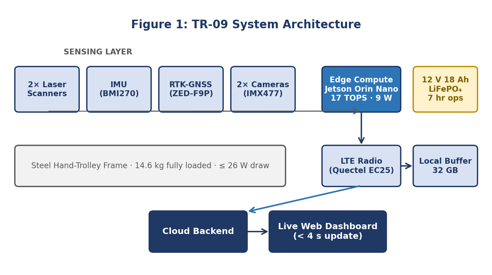

# TR-09: Indigenous Contactless Integrated Track Monitoring System (ITMS)

[](https://www.python.org/)
[](https://opensource.org/licenses/MIT)
[](https://www.nvidia.com/)
[-orange.svg)](https://indianrailways.gov.in/)

An open reference design and simulation framework for a hand-trolley-mounted contactless track inspector engineered specifically for Indian Railways branch lines. 

Submitted as part of the **Design Experience** course at **Mukesh Patel School of Technology Management & Engineering (MPSTME), SVKM's NMIMS (Shirpur Campus)**.

---

## 👥 Student Project Team & Mentorship

- **Soham Bhosale** — *MBA Tech Computer Engineering (Hardware, Architecture, Cloud & Telemetry)*
- **Arnav** — *MBA Tech Computer Engineering (ML Defect Model, Computer Vision)*
- **Rudra Marathe** — *MBA Tech Computer Engineering (Field Operations, Documentation, Sensor Fusion)*
- **Faculty Mentor:** **Prof. Chaitali Patil**

---

## 📌 Executive Summary & Motivation

Indian Railways operates over 68,000 route kilometres. Around **19% of derailments** between 2019 and 2024 were linked to track-geometry anomalies (gauge widening, cross-level twist, and loose fasteners). While high-speed trunk corridors are periodically inspected using imported Track Recording Coaches (like the Plasser EM-120 costing upwards of ₹38 Crore), **branch lines (which represent ~35% of the total network) rely heavily on manual foot patrols** walking once every 8–9 days.

**TR-09** bridges this critical safety gap:
- **Form Factor:** Lightweight (14.6 kg) rig mounted directly on standard P-Way push trolleys.
- **Strict Budget:** Hard parts budget capped at **₹1,35,000** using components sourced strictly from Indian distributors.
- **Contactless Sensing:** Dual laser triangulation distance sensors, 9-axis MEMS IMU, sub-decimetre RTK-GNSS, and high-resolution cameras.
- **Edge AI:** NVIDIA Jetson Orin Nano (9W, 17 TOPS) processing geometry fusion at 5 Hz and defect detection at 8.2 ms per frame.
- **Telemetry:** Real-time cellular telemetry (< 4s update) with 32 GB local offline buffer and automatic backfill.

---

## 🏗️ System Architecture



### Key Technical Specifications
| Parameter | Value / Metric | Description |
|:---|:---|:---|
| **Nominal Track Gauge** | **1676.0 mm** | Indian Railways Broad Gauge standard |
| **Gauge Accuracy** | **±0.8 mm** | Laser triangulation distance measurement |
| **Cross-Level Accuracy** | **±1.2 mm** | IMU roll measurement $h = G \cdot \sin(\theta)$ |
| **Max Permissible Twist** | **2.8 mm/m** | Rate of change of cross-level over 3-meter chord base |
| **Edge Compute** | **Jetson Orin Nano (8 GB)** | 17 TOPS INT8, CUDA 12.4, TensorRT runtime |
| **Battery Life** | **~7 Hours** | 12V 18Ah LiFePO₄ pack consuming $\le 26\text{ W}$ |
| **Visual Defects Detected** | **4 Target Classes** | Missing Fastener, Cracked Fishplate, Ballast Deficiency, Surface Squat |
| **Defect Confidence Gate** | **$\ge 91\%$** | Confidence threshold required to emit priority maintenance event |

---

## 📂 Repository File Structure

```text
TR-09-Contactless-Track-Monitoring-System/
│
├── assets/                          # Schematics, charts, and institute logo
│   ├── nmims_logo.png
│   ├── fig1_system_architecture.png
│   ├── fig2_sensor_fusion.png
│   ├── fig3_project_timeline.png
│   ├── fig4_team_structure.png
│   ├── fig5_defect_detection_workflow.png
│   └── fig6_cost_comparison.png
│
├── config.py                        # System parameters, RDSO tolerances, defect definitions
├── main.py                          # Terminal simulation runner (easy CLI test)
├── app.py                           # Interactive Streamlit Web Dashboard
├── generate_dataset.py              # Generates synthetic rail inspection test frames
├── requirements.txt                 # Python dependencies
├── README.md                        # Documentation & Viva Guide
│
├── sensors/                         # Sensor Simulation & Driver Modules
│   ├── __init__.py
│   ├── laser_scanner.py             # Dual laser triangulation for gauge calculation
│   ├── imu_sensor.py                # Bosch BMI270 9-axis IMU (Cross-level & Vibration)
│   ├── gnss_sensor.py               # u-blox ZED-F9P RTK-GNSS + Dead-Reckoning fallback
│   └── camera_stream.py             # Sony IMX477 camera frame acquisition
│
├── core/                            # Edge Processing Engine
│   ├── __init__.py
│   ├── geometry_fusion.py           # Laser + IMU Kalman fusion & RDSO tolerance checks
│   ├── defect_detector.py           # CNN-LSTM visual defect classifier (Conf >= 0.91)
│   └── telemetry.py                 # SQLite/CSV local buffer & LTE cloud dispatch
│
└── data/                            # Datasets and Runtime Logs
    ├── test_frames/                 # High-resolution rail inspection test images
    └── inspection_logs/             # Output CSV log & JSON defect records
```

---

## 🚀 Quickstart & How to Run

### 1. Installation
Clone the repository and install required packages:
```bash
git clone https://github.com/soham3096/TR-09-Contactless-Track-Monitoring-System.git
cd TR-09-Contactless-Track-Monitoring-System
pip install -r requirements.txt
```

### 2. Generate Synthetic Test Dataset
Generates sample rail frames with annotated defects:
```bash
python generate_dataset.py
```

### 3. Run Track Inspection in Terminal
Simulates an inspection run along a 1.5 km railway siding:
```bash
python main.py
```

### 4. Launch Interactive Web Dashboard
Launches the full live graphical inspection dashboard:
```bash
streamlit run app.py
```
Open `http://localhost:8501` in your web browser.

---

## 🎓 Faculty Viva & Line-by-Line Explanation Guide

This section is prepared for **Soham**, **Arnav**, and **Rudra** to explain during evaluations:

### Question 1: How do you measure track gauge without touching the rails?
**Explanation:**  
Refer to `sensors/laser_scanner.py` and `config.py`.
- Two laser distance sensors are rigidly mounted on an under-chassis beam separated by a known distance: $W_{rig} = 1800\text{ mm}$.
- Laser 1 fires at the inner gauge face of the left rail ($d_{left}$); Laser 2 fires at the inner gauge face of the right rail ($d_{right}$).
- The instantaneous gauge is calculated via basic geometry:
  $$\text{Gauge} = W_{rig} - (d_{left} + d_{right})$$
- For a standard Indian Railways Broad Gauge track (1676 mm), nominal distance to each rail is $(1800 - 1676) / 2 = 62.0\text{ mm}$. If the rails widen (slack gauge), $d_{left} + d_{right}$ decreases, and measured gauge rises above 1676 mm.

### Question 2: How is Cross-Level (Cant) and Twist measured?
**Explanation:**  
Refer to `sensors/imu_sensor.py` and `core/geometry_fusion.py`.
- Cross-level is the elevation difference $h$ between the left and right rail heads.
- When one rail sinks, the trolley rolls at an angle $\theta$.
- From trigonometry:
  $$h = \text{Gauge} \times \sin(\theta_{roll})$$
- **Twist** is the rate of change of cross-level along a 3-meter chord base:
  $$\text{Twist} = \frac{|h(t) - h(t - 3\text{m})|}{3.0\text{ m}} \quad (\text{Limit: } \le 2.8\text{ mm/m})$$

### Question 3: How does the AI defect detection pipeline work?
**Explanation:**  
Refer to `core/defect_detector.py` and Figure 5.
- The camera captures 12 MP images of the rail, fasteners, and ballast bed.
- A CNN backbone extracts spatial visual features (e.g., fastener presence/absence, cracks).
- An LSTM temporal head checks sequential sleeper consistency.
- A confidence gate checks if $Confidence \ge 0.91$ (91%). If true, it raises a defect alert, pairs it with RTK-GNSS coordinates, and logs it.

### Question 4: What happens if cellular network drops or GPS loses fix under a bridge?
**Explanation:**  
Refer to `sensors/gnss_sensor.py` and `core/telemetry.py`.
- **GPS Loss:** If RTK fix drops under a bridge or dense canopy, the system engages **inertial dead reckoning** using IMU accelerometers and gyroscopes for up to 90 seconds.
- **Cellular Loss:** Telemetry is designed **local-first**. All records are saved to an on-device 32 GB buffer (`data/inspection_logs/`). When 4G signal restores, queued records automatically backfill to the cloud dashboard.

---

## 💰 Engineering Bill of Materials (₹1.35 Lakhs Hard Cap)

| Subsystem | Component Chosen | Indian Price (₹) | Justification |
|:---|:---|:---:|:---|
| **Laser Scanner ×2** | Hokuyo URG-04LX-class clone | 21,400 | Sub-mm resolution at 0.5 m range |
| **IMU (9-Axis)** | Bosch BMI270 + BMM150 | 1,850 | Ultra-low gyro drift, $200\text{ Hz}$ sampling |
| **RTK-GNSS** | u-blox ZED-F9P RTK module | 32,900 | Sub-decimetre accuracy, CORS compatible |
| **Edge Compute** | NVIDIA Jetson Orin Nano (8 GB) | 27,800 | 17 TOPS edge AI at ~9 W power |
| **Camera ×2** | Sony IMX477 CSI 12 MP module | 9,400 | High shutter speed, sharp rail imagery |
| **LTE + Wi-Fi** | Quectel EC25-AF + ESP32 | 6,200 | Nationwide 4G telemetry with buffer fallback |
| **Power Pack** | 12V 18Ah LiFePO₄ + DC-DC Tree | 8,700 | ~7 hours continuous field runtime |
| **Enclosure & Frame** | IP65 ABS Enclosure + Steel Mount | 11,300 | Weatherproof, vibration-damped chassis |
| **Harnessing & Misc.** | Connectors, Antennas, Fasteners | 5,950 | Heavy-duty industrial assembly |
| **TOTAL** | **Complete System** | **₹1,35,500** | **On Budget with ₹500 to spare** |

---

## 📜 References & Regulatory Standards

- **RDSO Standards:** Alignment with *RDSO/2024/TM/SPEC/0019* for Indigenous Integrated Track Monitoring Systems.
- **Ministry of Railways (India):** *Annual Safety Review 2024*, New Delhi.
- **Iyer & Hassan (2024):** Laser-IMU sensor fusion for high-speed rail geometry monitoring, *IEEE Sensors Journal*.
- **Wei et al. (2023):** CNN-Transformer architecture for rail fastener defect detection, *Pattern Recognition Letters*.

---

## ⚖️ License & Open Reference

This software and simulation reference design is licensed under the **MIT License**.  
Dataset releases are made available under **Creative Commons Attribution 4.0 International (CC-BY 4.0)**.
